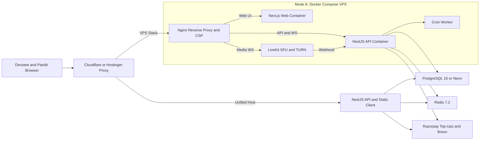
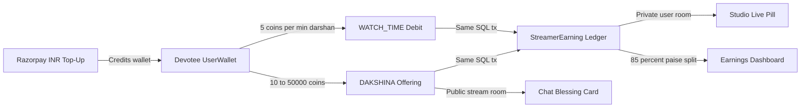
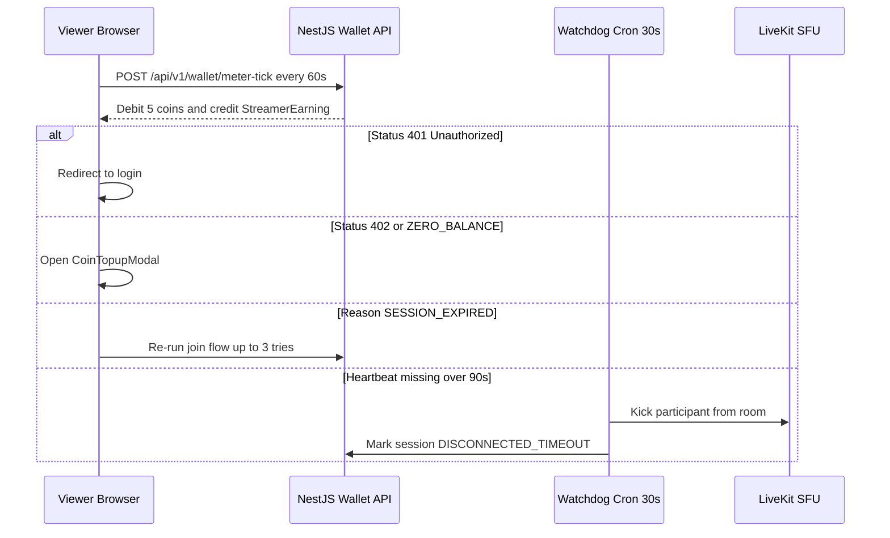

<div align="center">


# Shubhdarshan

**Sacred Pooja, Live Darshan & Vedic Astrology Streaming Platform**

*Self-hosted WebRTC media infrastructure paired with a Sacred Coin economy (`150 coins = ₹100`), atomic coin-only Dakshina, live 85% streamer Studio telemetry, encrypted private pooja rooms, Razorpay coin top-ups, and DPDP Act 2023 controls.*

<p>
  
  
  
  
  
  
  
  
</p>

<p>
  <a href="#architecture"><strong>Architecture</strong></a> &nbsp;&bull;&nbsp;
  <a href="#sacred-coin-economy--earnings"><strong>Coin Economy</strong></a> &nbsp;&bull;&nbsp;
  <a href="#security--billing-design"><strong>Security &amp; Billing</strong></a> &nbsp;&bull;&nbsp;
  <a href="#local-development--testing"><strong>Quick Start</strong></a> &nbsp;&bull;&nbsp;
  <a href="#production-deployment"><strong>Production</strong></a> &nbsp;&bull;&nbsp;
  <a href="#operations--maintenance"><strong>Operations</strong></a>
</p>

</div>

---

## Highlights at a Glance

<table>
  <tr>
    <td width="50%" valign="top">
      <h3>Real-Time Sacred Streaming</h3>
      <p>
        Self-hosted <strong>LiveKit v1.7.2</strong> SFU in single-UDP port mode (<code>7882/udp</code>) with TCP fallback and built-in TURN/STUN relays — zero transcoding overhead, instant participant eviction, and automated room reconciliation.
      </p>
    </td>
    <td width="50%" valign="top">
      <h3>Coin-Only Economy &amp; Live Studio Earnings</h3>
      <p>
        Unified <code>150 coins = ₹100</code> rate across metered darshan (<code>5 coins/min</code>) and coin Dakshina (<code>10–50,000 coins</code>). Every debit writes an atomic <code>StreamerEarning</code> row in one SQL transaction and streams live <code>+N</code> updates to the Acharya's private Studio pill.
      </p>
    </td>
  </tr>
  <tr>
    <td width="50%" valign="top">
      <h3>Private Interactive Pooja Rooms</h3>
      <p>
        128-bit secret links indexed by SHA-256 digest, AES-256-GCM encrypted metadata, <code>bcryptjs</code>-hashed room passwords, capacity gates, and active-user JWT checks across HTTP join and Socket.IO chat.
      </p>
    </td>
    <td width="50%" valign="top">
      <h3>Zero-Trust Ops &amp; DPDP 2023</h3>
      <p>
        Boot-time secret checks (<code>validate-env.ts</code>), TOTP 2FA gate on <code>/admin</code>, 18+ DPDP consent records, KYC review workflow, Indic NFKC chat filtering, and daily encrypted Cloudflare R2 backups.
      </p>
    </td>
  </tr>
</table>

---

## Architecture

Shubhdarshan runs from a single codebase across **two production deployment topologies**: a full Docker Compose Linux VPS stack behind Nginx, or a unified Node.js single-origin host (such as Hostinger + Neon PostgreSQL) where Express serves both `/api/v1` and the verified Next.js static export in `backend/public/client`.



| Layer | Technology | Responsibility |
| :--- | :--- | :--- |
| **Frontend Web** | Next.js 14 (App Router), React 18, Tailwind CSS | Static export (`backend/public/client`) via `scripts/sync-client.sh` or standalone SSR container (`BUILD_STANDALONE=true`) |
| **Video SFU & TURN** | LiveKit Server `v1.7.2` + `@livekit/components-react` | `7882/udp` media, `7881/tcp` fallback, `3478/udp` + `5349/tcp` TURN, rendered from `livekit/livekit.yaml.template` |
| **Backend API & WS** | NestJS 10, Prisma 5, Socket.IO (`@socket.io/redis-adapter`) | REST `/api/v1/*`, Helmet CSP, global `@Throttle()`, raw-body webhooks, live chat, Dakshina & private Studio telemetry |
| **Background Worker** | NestJS Application Context (`worker.main.ts`) | 30s coin-meter eviction, disconnect watchdog, LiveKit room reconciler, 15m stream reminders, DPDP purge |
| **Database & Cache** | PostgreSQL 16 (or Neon Pooled/Unpooled) + Redis 7.2 | Least-privilege `pooja_app` runtime DB role (`backend/docker/initdb/01-app-role.sh`) + `noeviction` Redis |

---

## Sacred Coin Economy & Earnings

All monetary flows follow a strict **INR-in / Coin-inside** model defined identically in [`economy.constants.ts`](backend/src/common/config/economy.constants.ts) and [`economy.ts`](frontend/src/lib/economy.ts):

- **Fixed Conversion Rate:** `COINS_PER_100_INR = 150` (**1 coin = ₹0.6667**), computed in integer paise (`grossPaise`, `netPaise`, `feePaise`) and rounded to 2 decimals only at the API/display layer so `netInr + platformFeeInr === grossInr` always holds without float drift.
- **Revenue Split:** `STREAMER_SHARE_PERCENT = 85` (**85% Acharya payout / 15% platform fee**) across both metered watch-time and coin Dakshina.
- **Strict Separation of INR & Coins:** Razorpay checkout is used **only** for Sacred Coin pack purchases (`POST /api/v1/wallet/topup/*` + `/api/v1/payments/webhook`). Direct INR Dakshina endpoints and webhook branches are retired; legacy INR `DakshinaOffering` records remain preserved and reported separately in streamer analytics.
- **Welcome Bonus:** Every newly registered devotee wallet receives **100 Sacred Coins** (`JOINING_BONUS`).



### Sacred Coin Packages & Economy Endpoints

<table>
  <tr>
    <td width="50%" valign="top">
      <strong>Seeded Coin Packs (<code>150 coins = ₹100</code>)</strong>
      <table>
        <thead>
          <tr>
            <th>SKU</th>
            <th>Pack</th>
            <th>Base + Bonus</th>
            <th>Price</th>
          </tr>
        </thead>
        <tbody>
          <tr>
            <td><code>shubh_150</code></td>
            <td>Shubh Starter</td>
            <td>150 coins</td>
            <td>₹100</td>
          </tr>
          <tr>
            <td><code>bhakti_330</code></td>
            <td>Bhakti Pack</td>
            <td>300 + 30 (+10%)</td>
            <td>₹200</td>
          </tr>
          <tr>
            <td><code>siddhi_900</code></td>
            <td>Siddhi Pack</td>
            <td>750 + 150 (+20%)</td>
            <td>₹500</td>
          </tr>
          <tr>
            <td><code>mahodadhi_1875</code></td>
            <td>Mahodadhi Pack</td>
            <td>1,500 + 375 (+25%)</td>
            <td>₹1,000</td>
          </tr>
        </tbody>
      </table>
    </td>
    <td width="50%" valign="top">
      <strong>Core Economy API &amp; Socket Events</strong>
      <table>
        <thead>
          <tr>
            <th>Surface</th>
            <th>Contract</th>
          </tr>
        </thead>
        <tbody>
          <tr>
            <td><code>POST /api/v1/payments/dakshina</code></td>
            <td>Atomic coin Dakshina; returns <code>402 INSUFFICIENT_COINS</code> if low, <code>403</code> on self-tip</td>
          </tr>
          <tr>
            <td><code>GET /api/v1/payments/dakshina/stream/:streamId</code></td>
            <td>Recent coin offerings leaderboard/feed for a broadcast</td>
          </tr>
          <tr>
            <td><code>GET /api/v1/streamers/earnings</code></td>
            <td>Total coins, <code>DAKSHINA</code> vs <code>WATCH_TIME</code> split, 85% net INR, per-stream &amp; legacy INR totals</td>
          </tr>
          <tr>
            <td><code>GET /api/v1/streamers/streams/:id/earnings</code></td>
            <td>Per-stream coin &amp; INR summary (streamer or admin only, <code>no-store</code>)</td>
          </tr>
          <tr>
            <td><code>stream:earnings_updated</code></td>
            <td>Emitted privately to <code>user:&lt;streamerId&gt;</code>; drives the Studio coin pill &amp; <code>+N</code> delta badge</td>
          </tr>
        </tbody>
      </table>
    </td>
  </tr>
</table>

---

## Security & Billing Design

### Metered Sacred Coins Lifecycle



### Guardrails Built Into Code

| Control Area | Implementation | Source |
| :--- | :--- | :--- |
| **Atomic Dual-Ledger Billing** | Every watch-minute (`startViewingSession` + `processMeterTick`) and Dakshina (`sendCoinDakshina`) executes an atomic conditional `UPDATE ... WHERE balanceCoins >= X` + `WalletTransaction` (`DEBIT`) + `StreamerEarning` (`WATCH_TIME` / `DAKSHINA`) inside one `$transaction` with unique idempotency keys | [`wallet.service.ts`](backend/src/modules/wallet/wallet.service.ts), [`payments.service.ts`](backend/src/modules/payments/payments.service.ts) |
| **Shared Economy Constants** | Single source of truth for `COINS_PER_100_INR = 150`, `STREAMER_SHARE_PERCENT = 85`, `COINS_PER_MINUTE = 5`, integer-paise math, and pack SKUs across backend and frontend | [`economy.constants.ts`](backend/src/common/config/economy.constants.ts), [`economy.ts`](frontend/src/lib/economy.ts) |
| **Private Studio Telemetry** | Authenticated WebSockets join `user:<userId>`; `emitEarningsUpdated` targets only `user:<streamerId>` and never broadcasts streamer revenue into viewer `stream:<streamId>` rooms | [`chat.gateway.ts`](backend/src/modules/chat/chat.gateway.ts) |
| **Boot Secret Validation** | Hard fails in `NODE_ENV=production` on placeholder strings, duplicate access/refresh JWT secrets, missing `ENCRYPTION_MASTER_KEY`, or invalid `FRONTEND_ORIGIN` | [`validate-env.ts`](backend/src/common/config/validate-env.ts) |
| **Admin 2FA Gate** | Passwords hashed with `bcryptjs` (cost 12); TOTP 2FA (`otplib`) with 5-attempt challenge lock; `/admin` verifies live `/api/v1/auth/me` role & 2FA state | [`auth.service.ts`](backend/src/modules/auth/auth.service.ts) |
| **Private Pooja Rooms** | 128-bit link secret (SHA-256 hash lookup), AES-256-GCM token encryption, `bcryptjs` password check, blocklist & active-user validation | [`private-links.service.ts`](backend/src/modules/private-links/private-links.service.ts) |
| **Rate Limiting & CSP** | Global `ThrottlerModule` (`300` req/min default, `@SkipThrottle()` on health probes, webhooks, and `meter-tick`) + Helmet / Nginx CSP headers | [`app.module.ts`](backend/src/app.module.ts), [`main.ts`](backend/src/main.ts) |
| **Moderation & Chat Safety** | 60-second synced `IndicWordFilter` with Devanagari/NFKC normalization on both chat and Dakshina names/prayers, kick/ban socket sync, verified socket JWT lookup | [`chat.service.ts`](backend/src/modules/chat/chat.service.ts) |
| **Wallet & Earnings No-Cache** | `Cache-Control: no-store, no-cache, must-revalidate, private` on wallet balance, ledger, and streamer earnings endpoints + Razorpay HMAC signature verification | [`wallet.controller.ts`](backend/src/modules/wallet/wallet.controller.ts), [`streamers.controller.ts`](backend/src/modules/streamers/streamers.controller.ts) |

---

## Repository Reference

<details>
<summary><strong>Explore Full Directory Tree &amp; Module Map</strong></summary>

```text
├── backend/                              # NestJS API, WebSockets, Static Host & Worker
│   ├── docker/initdb/                    # 01-app-role.sh (creates least-privilege pooja_app DB role)
│   ├── prisma/
│   │   ├── migrations/
│   │   │   ├── 20261107000000_init/      # Core schema (Users, Streams, Wallets, Chat, KYC)
│   │   │   ├── 20261109000001_add_password_changed_at/
│   │   │   └── 20261112000001_coin_only_economy/  # StreamerEarning ledger, DakshinaOffering.coins, 150-coin packs
│   │   ├── schema.prisma                 # Data model + StreamerEarningSource & DAKSHINA_OFFERING ledger
│   │   ├── seed.ts                       # Admin, categories, word filter, CMS pages & coin packs
│   │   ├── seed-wallet.ts                # Idempotent standalone coin-package & welcome-wallet sync
│   │   └── reseed-accounts.ts            # Demo account/profile seed utility
│   ├── public/
│   │   ├── client/                       # Verified Next.js static export served by Express
│   │   └── uploads/                      # Public uploaded thumbnails/assets
│   ├── scripts/
│   │   ├── test-wallet-system.ts         # Coin-only economy, meter-tick, Dakshina & earnings E2E tests
│   │   ├── test-neon-e2e.ts              # Live Neon DB schema & ledger verification script
│   │   └── test-full-api-suite.ts        # Full HTTP API regression suite
│   ├── src/
│   │   ├── common/
│   │   │   ├── config/
│   │   │   │   ├── economy.constants.ts  # COINS_PER_100_INR=150, 85% split, SKUs & integer-paise math
│   │   │   │   └── validate-env.ts       # Production boot secret & origin enforcement
│   │   │   ├── decorators/               # @Public, @Roles, @CurrentUser
│   │   │   ├── filters/                  # GlobalExceptionFilter
│   │   │   ├── guards/                   # JwtAuthGuard, RolesGuard, InternalKeyGuard
│   │   │   └── *.util.ts                 # crypto.util.ts, livekit-url.util.ts, payments.util.ts
│   │   ├── database/                     # PrismaModule & PrismaService
│   │   ├── jobs/                         # cron-tasks.service.ts (watchdogs, reconciler, retention)
│   │   ├── modules/
│   │   │   ├── admin/                    # KPIs, KYC approval queue, stream kill switch, CMS, filters
│   │   │   ├── auth/                     # JWT, bcryptjs, Google OAuth, 18+ DPDP gate, TOTP 2FA
│   │   │   ├── chat/                     # Socket.IO chat gateway, user:<id> telemetry, Indic NFKC filter
│   │   │   ├── health/                   # GET /api/v1/health/live & /api/v1/health/ready
│   │   │   ├── internal/                 # Internal live-stream count check (X-Internal-Key)
│   │   │   ├── notifications/            # Brevo transactional mailer & 15-minute alerts
│   │   │   ├── payments/                 # POST /payments/dakshina (coin-only), /payments/webhook (top-up)
│   │   │   ├── private-links/            # 128-bit SHA-256 invite links & AES-256-GCM room access
│   │   │   ├── reports/                  # Viewer safety report queue
│   │   │   ├── storage/                  # MIME/extension & 10 MB upload guard (local + private KYC)
│   │   │   ├── streamers/                # KYC onboarding, public profiles, /earnings & /streams/:id/earnings
│   │   │   ├── streams/                  # Scheduled/live stream lifecycle & capacity controls
│   │   │   ├── video/                    # LiveKit SFU provider & raw-body webhook controller
│   │   │   └── wallet/                   # Sacred Coins balance, packages, Razorpay top-up, meter-tick
│   │   ├── main.ts                       # HTTP API, Helmet CSP, robots/sitemap/llms, static client host
│   │   └── worker.main.ts                # Headless cron scheduler entry point
│   └── Dockerfile                        # Multi-stage build (migrate & runtime targets)
├── frontend/                             # Next.js 14 Web Application
│   ├── public/images/                    # Platform emblem & verified Pandit WebP portraits
│   ├── src/
│   │   ├── app/                          # /, /stream/[id], /studio/[id], /streamer/earnings, /join/[tokenSlug], /admin, /wallet/*, etc.
│   │   ├── components/                   # ChatWidget, DakshinaModal, CoinTopupModal, ConfirmDialog, etc.
│   │   └── lib/
│   │       ├── api.ts                    # Typed REST client
│   │       ├── economy.ts                # Frontend rate constants, paise breakdown & sd-wallet-updated sync
│   │       └── meter-tick.ts             # 60s meter-tick response classifier
│   ├── next.config.js                    # Dual mode: 'export' (default) or 'standalone'
│   └── Dockerfile                        # Standalone Next.js Docker build
├── livekit/
│   ├── livekit.yaml.template             # Source config template (__DOMAIN__, __LIVEKIT_API_KEY__)
│   └── livekit.yaml                      # Rendered config mounted into pooja_livekit
├── nginx/conf.d/
│   └── app.conf                    # Reverse proxy for web, api, socket.io, uploads, and live.*
├── nginx/cloudflare/               # Generated by refresh-cloudflare.sh (NOT inside conf.d, which nginx auto-includes)
│   ├── peers.conf                  # geo allow-list on the TCP peer (Cloudflare + private ranges)
│   └── realip.conf                 # CF-Connecting-IP restoration rules
├── scripts/
│   ├── backup-db.sh                      # Daily compressed + age-encrypted pg_dump to Cloudflare R2
│   ├── refresh-cloudflare.sh             # Monthly Cloudflare IPv4/IPv6 Nginx rule updater
│   ├── render-livekit-config.sh          # Validates env & atomically renders livekit/livekit.yaml
│   ├── renew-hook.sh                     # Safe Nginx reload & stream-aware LiveKit cert restart
│   ├── restore-db.sh                     # Decrypts .sql.gz.age archive & restores PostgreSQL
│   ├── sync-client.sh                    # Builds Next.js export, validates assets/fonts, updates client
│   └── sysctl-webrtc.conf                # Linux UDP buffer & file-descriptor tuning
├── .env.example                          # Complete documented environment template
└── docker-compose.yml                    # 8-service production Compose stack
```

</details>

<details>
<summary><strong>Background Worker Cron Schedule (<code>cron-tasks.service.ts</code>)</strong></summary>

| Schedule | Job | Action |
| :--- | :--- | :--- |
| Every `30s` | **Disconnect Watchdog** | Auto-ends streams stuck in `RECONNECTING_GRACE_PERIOD` past `120s` and closes active sessions |
| Every `30s` | **Coin Meter Watchdog** | Evicts viewers from LiveKit when `meter-tick` heartbeat lags `>90s` (including `lastTickAt IS NULL`) |
| Every `1m` | **LiveKit Room Reconciler** | Closes orphaned `LIVE` DB streams missing in LiveKit and cancels stale `SCHEDULED` streams `>48h` |
| Every `1m` | **Reminder Dispatcher** | Sends email alerts via Brevo 15 minutes before scheduled broadcasts |
| Daily `03:00 UTC` | **DPDP Retention Purge** | Deletes chat messages `>30 days` on ended streams and clears `ViewerSession.ipAddress` `>90 days` |

</details>

<details>
<summary><strong>Production Secret &amp; Boot Validation Rules (<code>validate-env.ts</code>)</strong></summary>

When `NODE_ENV=production`, startup aborts immediately if any rule below is violated:
- **JWT Secrets:** `JWT_ACCESS_SECRET` and `JWT_REFRESH_SECRET` must each be non-placeholder, `>= 32` chars, and **strictly distinct**.
- **2FA Challenge Secret:** `JWT_2FA_SECRET` (recommended `>= 32` chars and distinct from access/refresh); if omitted, an independent key is derived via `HMAC-SHA256(JWT_ACCESS_SECRET)`.
- **Data Encryption Key:** `ENCRYPTION_MASTER_KEY` must be a valid non-placeholder 32-byte key (`openssl rand -base64 32`).
- **LiveKit Credentials:** `LIVEKIT_API_KEY` and `LIVEKIT_API_SECRET` reject default/placeholder values (`pooja`, `devkey`, `replace_with_*`), require `>= 32` chars on the secret, and reject `:`, `#`, quotes, or spaces.
- **Canonical Origin:** `FRONTEND_ORIGIN` must be a clean `https://` origin with no path, query, hash, loopback host, or placeholder domain (normalized to `origin` for CORS, `robots.txt`, `sitemap.xml`, `llms.txt`, and transactional emails).
- **Feature Safety Flags:** Keep `ALLOW_MOCK_PAYMENTS=false` and `NEXT_PUBLIC_BOOKINGS_ENABLED=false` in production unless backend booking APIs are enabled.

</details>

<details>
<summary><strong>Docker Compose Resource Allocation (<code>docker-compose.yml</code>)</strong></summary>

- `postgres` (`1536m`) &bull; `livekit` (`1536m`) &bull; `api` (`1024m`) &bull; `web` (`768m`) &bull; `worker` (`512m`) &bull; `redis` (`384m`) &bull; `nginx` (`128m`)

</details>

---

## Local Development & Testing

### Prerequisites
- **Node.js** `20+`, **PostgreSQL** `16+` (or Neon), **Redis** `7.2+`, and a **LiveKit** server instance.

### 1. Configure Environment
```bash
cp .env.example .env
# Populate DATABASE_URL, DATABASE_URL_UNPOOLED, REDIS_URL, JWT secrets, ENCRYPTION_MASTER_KEY, LIVEKIT_*
```

### 2. Start Backend API & Worker
```bash
cd backend
npm install
npx prisma generate
npx prisma migrate deploy
npm run prisma:seed
npx ts-node prisma/seed-wallet.ts   # Optional: standalone idempotent coin-package sync
npm run start:dev
```
- API listens on `http://localhost:4000/api/v1` (Swagger docs at `/api/docs` when `NODE_ENV !== 'production'` or `ENABLE_SWAGGER=true`).
- Run the headless cron worker separately when testing watchdogs locally: `npm run start:worker`.

### 3. Start Frontend Dev Server
```bash
cd frontend
npm install
npm run dev
```

### 4. Verification & Typechecks
```bash
# Typecheck backend & frontend
cd backend && npx tsc --noEmit
cd ../frontend && npx tsc --noEmit

# Run coin economy, Neon, and API verification suites (from backend/)
cd ../backend
npx ts-node scripts/test-wallet-system.ts   # Coin Dakshina, 5-coin meter-tick, StreamerEarning & RBAC checks
npx ts-node scripts/test-neon-e2e.ts        # Database & migration sanity suite
npm run test:e2e:all                        # Full HTTP regression suite (requires non-2FA test credentials or 2FA token)
```

### 5. Sync Unified Static Client Before Release
Whenever anything inside `frontend/` changes and you deploy Express as the unified host:
```bash
bash scripts/sync-client.sh
```
This runs a clean `npm ci` + `npm run build` (`output: 'export'`, with `NEXT_PUBLIC_BOOKINGS_ENABLED=false` for static hosting), verifies every HTML entry point, `/_next/static/*` bundle reference, and self-hosted `.woff2` font file, and swaps `backend/public/client` atomically. Commit the refreshed `backend/public/client` output before pushing.

---

## Production Deployment

Choose the deployment playbook that matches your infrastructure:

### Track A — Full Self-Hosted Linux VPS (Docker Compose + LiveKit + Nginx)

#### Network & DNS Checklist

**UFW Firewall Ports**

| Port / Protocol | Service |
| :--- | :--- |
| `22/tcp` | SSH (key auth only) |
| `80/tcp`, `443/tcp` | Nginx HTTP/2 &amp; TLS termination |
| `7881/tcp` | LiveKit WebRTC TCP fallback |
| `7882/udp` | LiveKit single-UDP media port |
| `3478/udp`, `5349/tcp` | LiveKit embedded TURN / STUN |
| `30000-30050/udp` | LiveKit TURN relay port range |

**Cloudflare DNS Routing**

| Hostname | Proxy Mode | Purpose |
| :--- | :--- | :--- |
| `your-domain.com`, `www.your-domain.com` | **Proxied** (Orange Cloud) | Web UI, REST API &amp; Socket.IO via Nginx |
| `live.your-domain.com`, `turn.your-domain.com` | **DNS Only** (Grey Cloud) | Direct WebRTC signaling &amp; TURN media paths |

#### Server Provisioning Steps

```bash
# 1. Clone into /opt/pooja and prepare secrets
sudo mkdir -p /opt/pooja && sudo chown "$USER:$USER" /opt/pooja
git clone https://github.com/AnkitTiwari2005/LIVE-STREAM.git /opt/pooja
cd /opt/pooja

cp .env.example .env.production
chmod 600 .env.production
# Fill real domain, DB, Redis, JWT, LiveKit, Razorpay, Brevo, and ADMIN_* variables

# 2. Validate credentials & render livekit/livekit.yaml atomically
bash scripts/render-livekit-config.sh .env.production

# 3. Update domain in nginx/conf.d/app.conf & fetch Cloudflare IP ranges
bash scripts/refresh-cloudflare.sh

# 4. Tune Linux UDP buffers for WebRTC
sudo cp scripts/sysctl-webrtc.conf /etc/sysctl.d/99-webrtc.conf
sudo sysctl --system

# 5. Issue Let's Encrypt certificates
sudo certbot certonly --standalone \
  -d your-domain.com -d www.your-domain.com \
  -d live.your-domain.com -d turn.your-domain.com

# 6. Build & start containers (runs migrate -> api, worker, web, livekit, nginx)
docker compose --env-file .env.production up -d --build

# 7. Seed initial categories, word filter, coin packs, CMS pages & admin account
docker exec -it pooja_api npm run prisma:seed
```

---

### Track B — Unified Node.js Host (Hostinger + Neon PostgreSQL + Redis)

1. **Sync Client Assets:** Run `bash scripts/sync-client.sh` locally (or build `frontend/` with `NEXT_PUBLIC_BOOKINGS_ENABLED=false` and copy `frontend/out` → `backend/public/client`) and commit `backend/public/client` so Express serves updated hashed bundles.
2. **Configure Host Settings:**
   - **Application Root:** `backend`
   - **Build Command:** `npm run build` (`npx prisma generate && nest build`)
   - **Start Command:** `npm run start:prod` (`node dist/main`)
3. **Set Production Environment Variables:** Supply `NODE_ENV=production`, `FRONTEND_ORIGIN`, `DATABASE_URL`, `DATABASE_URL_UNPOOLED`, `REDIS_URL`, `JWT_ACCESS_SECRET`, `JWT_REFRESH_SECRET`, `JWT_2FA_SECRET`, `ENCRYPTION_MASTER_KEY`, `LIVEKIT_*`, `RAZORPAY_*`, `BREVO_API_KEY`, and set `RUN_CRONS=true` if no dedicated worker container is running.
4. **Migrate & Seed:** Run `npx prisma migrate deploy` and `npm run prisma:seed` (and `npx ts-node prisma/seed-wallet.ts` if refreshing packages on an existing DB) against your Neon PostgreSQL database, then purge CDN/edge cache after deployment.

---

## Admin Onboarding

> [!IMPORTANT]
> **No hardcoded production admin password ships in the repository.**
> `backend/prisma/seed.ts` reads `ADMIN_EMAIL` and `ADMIN_BOOTSTRAP_PASSWORD` (minimum 16 characters required in `NODE_ENV=production`). Enroll TOTP 2FA at `/account#2fa` immediately after signing in — `/admin` enforces both `role === 'ADMIN'` and `isTwoFactorEnabled === true` directly via `/api/v1/auth/me`.

---

## Operations & Maintenance

| Task | Command / Endpoint | Notes |
| :--- | :--- | :--- |
| **Liveness Probe** | `GET /api/v1/health/live` | Exempted from throttling (`@SkipThrottle()`); returns uptime & timestamp |
| **Readiness Probe** | `GET /api/v1/health/ready` | Executes `SELECT 1` against PostgreSQL; returns `503` if disconnected |
| **Daily Encrypted Backup** | `0 2 * * * /opt/pooja/scripts/backup-db.sh >> /var/log/pooja-backup.log 2>&1` | Runs `pg_dump`, compresses with gzip, encrypts via `age`, uploads to Cloudflare R2 |
| **Disaster Recovery** | `sudo /opt/pooja/scripts/restore-db.sh /opt/pooja/backups/db_YYYYMMDD_HHMMSS.sql.gz.age` | Decrypts archive with host `age` private key and restores into `pooja_postgres` |
| **TLS Renew Hook** | `bash /opt/pooja/scripts/renew-hook.sh` | Reloads Nginx immediately; restarts LiveKit only when `/api/v1/internal/live-count` equals `0` |
| **Cloudflare IP Refresh** | `bash /opt/pooja/scripts/refresh-cloudflare.sh` | Regenerates `nginx/cloudflare/realip.conf` and `peers.conf`, validates with `nginx -t`, reloads (rolls back on failure) |

<div align="center">
  <br />
  <sub>Built for uninterrupted sacred darshan, fair Acharya coin earnings, resilient WebRTC streaming, and clean operator reliability.</sub>
</div>
